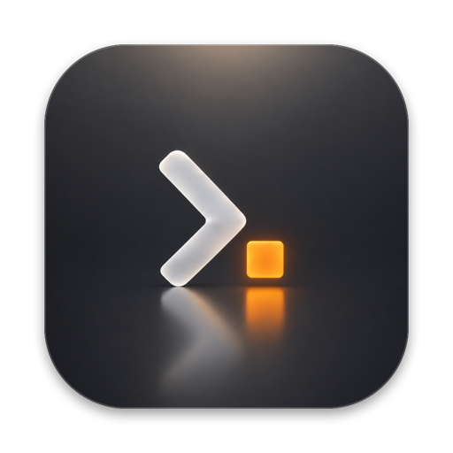

<p align="center">
  
</p>

<h1 align="center">ultracodefactory.com</h1>

<p align="center">
  The landing page for <strong>Ultra Code Factory</strong>, a native macOS kanban board for
  plain-markdown work cards, staffed by Claude Code agents.
  <br>
  <a href="https://ultracodefactory.com"><strong>ultracodefactory.com →</strong></a>
  ·
  <a href="https://github.com/melucasleite/ultracodefactory">App source</a>
</p>

---

## What's here

A single static page built with Next.js (App Router) and Tailwind CSS v4:

- **Aurora and glass styling** to match the app's Liquid Glass look, in plain
  CSS ([`src/app/globals.css`](src/app/globals.css)).
- **App window mock** ([`src/components/AppMock.tsx`](src/components/AppMock.tsx)),
  built in HTML and CSS rather than a screenshot, so it stays sharp at any size.
- **Interactive question demo**
  ([`src/components/QuestionDemo.tsx`](src/components/QuestionDemo.tsx)) showing
  how Ultra Code Factory turns Claude's terminal prompts into native buttons.
- **Generated Open Graph image**
  ([`src/app/opengraph-image.tsx`](src/app/opengraph-image.tsx)) for link previews.
- **Vercel Web Analytics** for privacy-friendly page views, with no cookies.

## The app

Ultra Code Factory itself (SwiftUI, MIT) lives at
[melucasleite/ultracodefactory](https://github.com/melucasleite/ultracodefactory).

## Develop

```bash
yarn install
yarn dev
```

## Build and deploy

```bash
yarn build
```

The site deploys automatically with Vercel: every push to `main` goes to
production at ultracodefactory.com, and other branches and pull requests get
preview URLs.

Formatting and linting:

```bash
yarn prettier --write src
yarn lint
```

## License

MIT. Ultra Code Factory is an independent project, not affiliated with or
endorsed by Anthropic.
